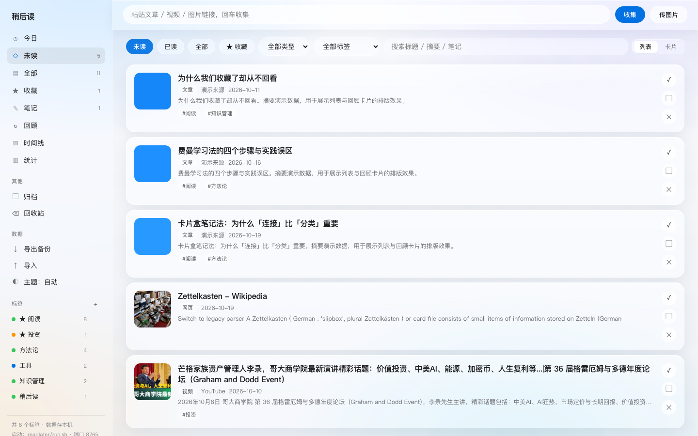
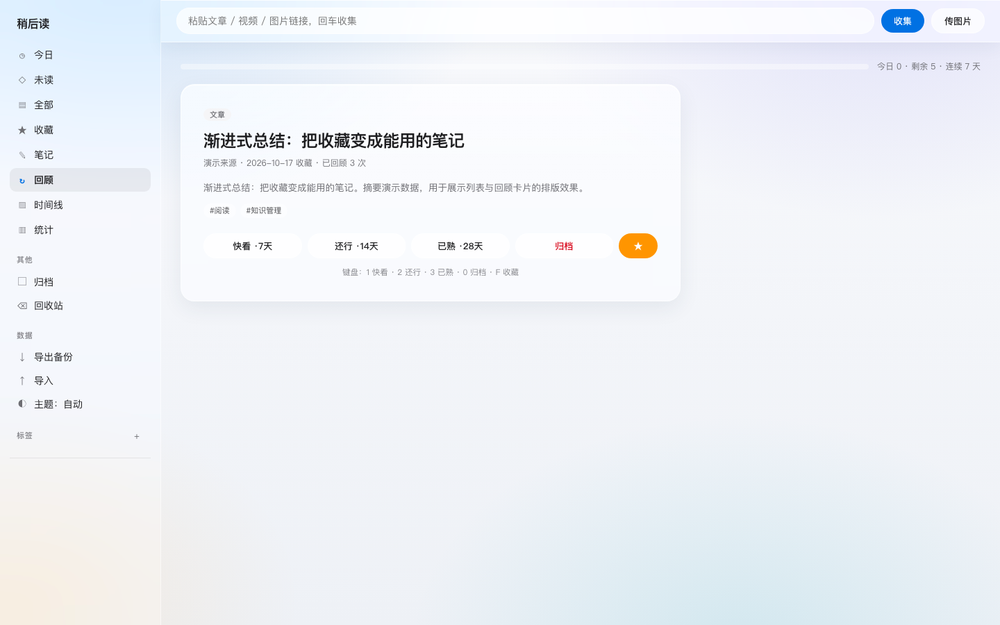
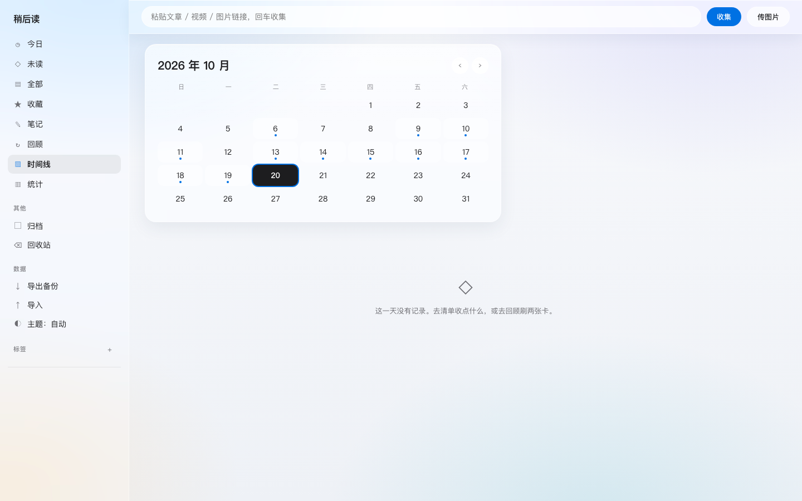
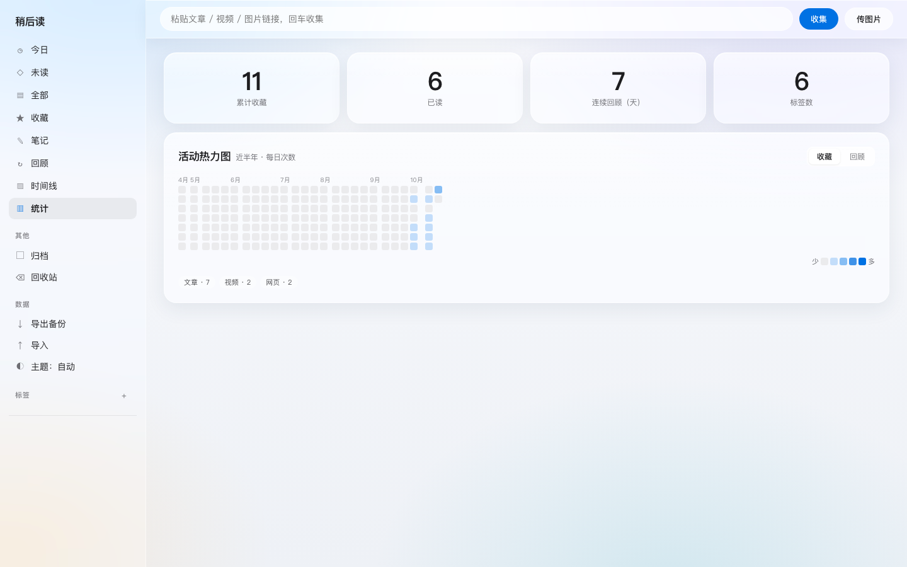
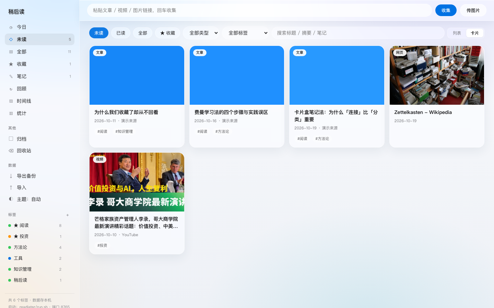
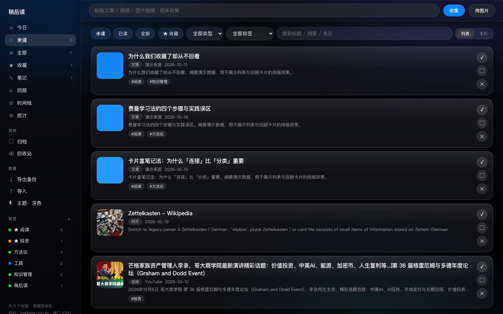
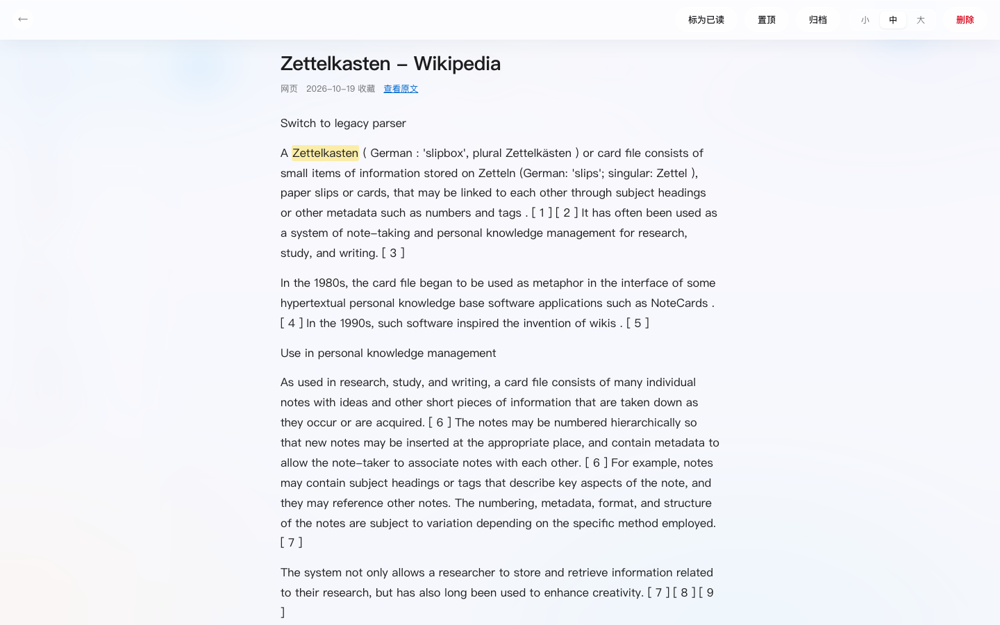

# ReadLater · 自建稍后读

**把微信里「稍后再看」的内容，收进自己的硬盘。**

本地部署 · 数据自有 · 微信文章一键收 · Readwise 式每日回顾



---

## 为什么又造一个稍后读

2024 年 11 月 Omnivore 关停，2025 年 7 月 Pocket 停服——收藏越多，平台风险越大。
而中文世界最常被收藏的内容恰好在微信里，多数工具收不进去。

ReadLater 只做三件事：

1. **微信里看到什么就收什么** —— 粘贴公众号文章链接，正文与配图转存本地，原文删了也能读
2. **收进来要真的看** —— Readwise 式间隔重现，每天 5 张卡，2 分钟看完
3. **数据是你自己的** —— 单个 SQLite 文件，拷走即备份；无账号、无云端、无订阅

## 界面

| 清单 · 筛选与搜索 | 每日回顾 · 间隔重现 |
|---|---|
|  |  |
| **时间线 · 月历与记录流** | **统计 · 热力图与连击** |
|  |  |

**卡片墙视图**（顶栏一键切换，`#grid` 深链接直达，偏好本地记忆）：



**Liquid Glass 暗色模式**（自动跟随系统，或手动切换；`#dark` / `#light` 深链接）：



**阅读器 · 划词高亮**（选中正文即高亮，摘录会出现在每日回顾里）：



## 功能

- **划词高亮**：阅读时选中任意句子 → 「高亮这句」；正文内联标记、按条目汇总、**摘录进入每日回顾卡片**（回顾单位从整条细化到句子）
- **数据主权**：一键**导出** JSON 全量备份（条目 / 正文 / 标签 / 回顾状态 / 高亮）；**导入**支持自己的备份与浏览器 / Pocket 书签 HTML（按 URL 去重）
- **暗色模式**：Liquid Glass 玻璃材质，自动跟随系统，也可手动切换（`#dark` / `#light` 深链接）；阅读器支持三档字号
- **收件通道**：界面粘贴框 / 浏览器书签（Bookmarklet）/ iOS 快捷指令 / 图片上传
- **组织**：侧栏带实时计数——今日 / 未读 / 全部 / 收藏 / 笔记 / 归档 / 回收站；条目可**置顶**（排序优先）
- **安全删除**：删除 = **移入回收站**（保留正文与配图），可逐条恢复或清空；与「归档」（处理完沉底、不占主列表）区分
- **笔记聚合**：「笔记」视图汇总所有写过想法的条目，不必逐条翻找
- **全文缓存**：公众号文章正文 + 配图本地转存，**原文被删也能读**；URL 去重；抓取失败仍保住链接
- **每日回顾**：三档间隔排期（快看 7 天 / 还行 14 天 / 已熟 28 天，间隔随曝光次数拉长），★ 收藏优先重现，连续天数统计
- **时间线**：月历选日期（有记录的日期带标记），下方按时间轴看当天的收藏 / 已读 / 回顾记录
- **标签管理**：颜色（同名恒同色）、置顶、改名（同步改写全部条目）、删除
- **统计**：近半年活动热力图（收藏 / 回顾双模式）、总览数字、类型分布
- **两种浏览模式**：列表 / **大封面卡片墙**（响应式 2–5 列，hover 显示快速操作），偏好存本地；`#grid` 深链接直达
- **界面**：Apple Liquid Glass 风格——半透明磨砂面板（backdrop-filter + 高光边缘）、环境渐变背景、中性冷灰 + 单一蓝 #0071e3；手机浏览器「添加到主屏幕」即为 App；支持深链接 `#review` `#timeline` `#stats` `#fav` `#grid` `#item=<id>`
- **键盘操作**：回顾页 `1` 快看 · `2` 还行 · `3` 已熟 · `0` 归档 · `F` 收藏

## 快速开始

### Docker（推荐，跨平台）

```bash
git clone https://github.com/liening1/readlater.git
cd readlater
docker compose up -d
# 打开 http://localhost:8765 ；数据落在 ./data
```

### 本机运行（macOS / Linux，需 Python 3.10+）

```bash
git clone https://github.com/liening1/readlater.git
cd readlater
./run.sh          # 首次运行自动创建 .venv 并安装依赖（共 5 个包）
# 打开 http://localhost:8765
```

手机与电脑同一 Wi-Fi 时访问 `http://<电脑IP>:8765`，浏览器「添加到主屏幕」即可使用。

### 收件配置

**浏览器书签**：新建书签，网址填入下面这行；在任何页面点击它即完成收藏。

```javascript
javascript:location.href='http://localhost:8765/collect?url='+encodeURIComponent(location.href)
```

**iOS 快捷指令**：`获取剪贴板` → `打开 URL`，URL 填 `http://localhost:8765/collect?url=[剪贴板]`。

## 网络说明（中国大陆）

- 微信域名（`mp.weixin.qq.com` 等）**直连**，不经过代理
- 其他外网先直连、失败自动走代理，可显式指定：

```bash
READLATER_PROXY=http://127.0.0.1:7897 ./run.sh
```

## 与其他方案对比

| | ReadLater | Cubox | Readwise Reader | Pocket / Omnivore |
|---|---|---|---|---|
| 数据位置 | **自己的硬盘** | 厂商云 | 厂商云 | 厂商云 |
| 价格 | 免费 | 订阅制 | $9.99/月 | 已停服 |
| 微信公众号文章 | ✅ 直收 + 全文缓存 | ✅ | ❌ | ❌ |
| 每日回顾 | ✅ 三档间隔 + 连击 | 部分 | ✅（最强） | ❌ |
| 可自己改代码 | ✅ MIT | ❌ | ❌ | 开源但已停服 |
| 局域网手机访问 | ✅ | ✅ | ✅ | — |

## 技术栈

Python FastAPI · SQLite（WAL，写操作串行化）· 原生 JS 单页（零构建）；依赖只有 5 个包。

```
readlater/
├── server.py          后端：收集 / 回顾调度 / 时间线 / 统计 / 标签
├── parser.py          解析：微信文章专项 + 通用 og 兜底 + 网络分流
├── static/index.html  前端单页：侧栏 + 五视图（含内联样式与脚本）
├── install.sh         一键创建 venv 并安装依赖
├── run.sh             启动（支持 PORT / HOST / READLATER_PROXY）
├── Dockerfile         容器化
├── tools/             开发工具：生成 / 清理演示数据（截图与试用）
└── data/              数据库与图片（不进版本控制；备份 = 拷走此目录）
```

## 已验证 / 待实测

**已验证（本机实测）**：收集入库、URL 去重、外网文章解析（直连失败自动代理兜底）、微信解析器结构测试、图片上传、标记已读、标签增删改（改名同步全部条目 / 删除剥离）、收藏筛选、**软删除 → 回收站 → 恢复 / 清空全链路**、归档与取消归档、条目置顶排序、今日与笔记筛选、侧栏计数一致性、**导出 JSON → 回导去重（0 新增 / N 跳过）**、**书签 HTML 导入（含重复跳过）**、**划词高亮增删查 + 正文内联标记**、暗色/浅色主题切换、8 路并发写入（SQLite WAL 下全部通过）、每日回顾排期与连续天数、时间线月历与事件流、`install.sh` 一键建环境 + `run.sh` 启动（macOS 实测）。

**待实测**：**Docker 部署**（Dockerfile 已提供但本机无 Docker 环境，未经实测）；微信公众号文章的线上解析（逻辑按公开页面结构实现，需真实文章链接验证；个别防爬文章会降级为「仅存链接」）；iOS 快捷指令与订阅号收件通道。

## 路线图

- [x] 收集 / 全文缓存 / 每日回顾 / 时间线 / 统计 / 标签管理 / Docker
- [ ] iOS 快捷指令模板与订阅号收件通道（需实测个人主体消息权限）
- [ ] 回顾定时推送（macOS 通知 / 邮件）
- [ ] LLM 自动摘要与打标（可接本地 Ollama，零成本）
- [ ] flomo Pro API 回流：回顾时的批注一键进 flomo

## License

MIT © 2026 Yusheng Shi
